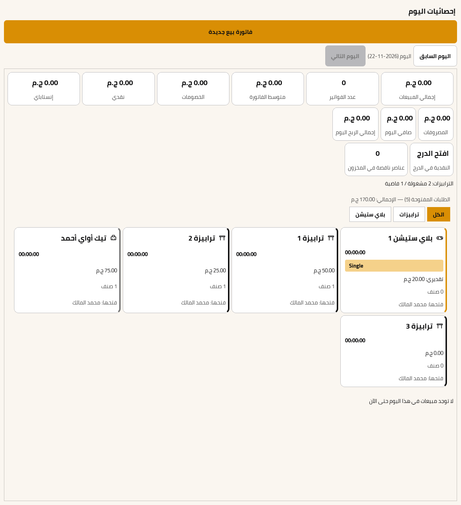
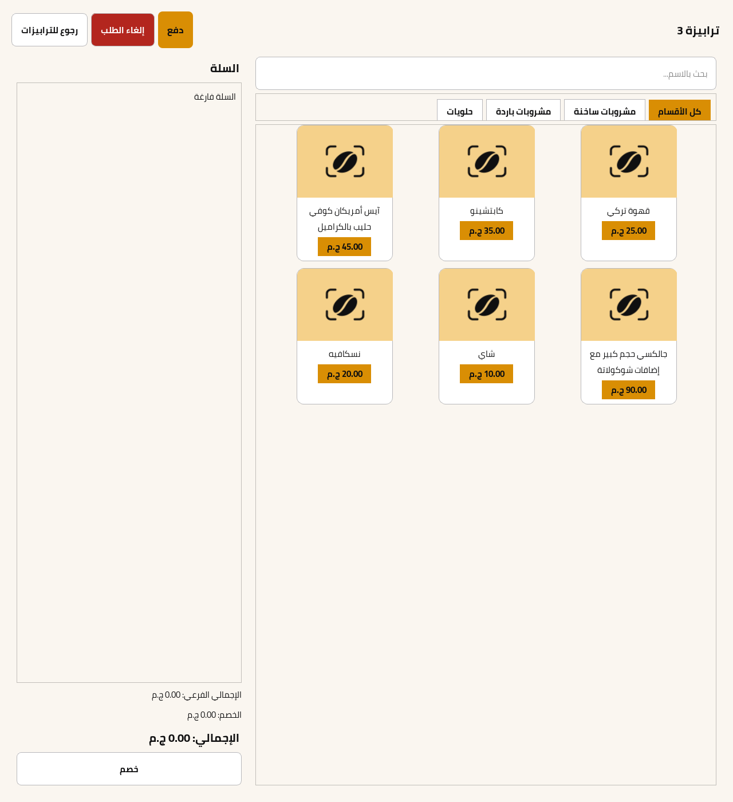

<div dir="rtl">

# ديربي (Derby) — نظام كاشير لكافيه وركن بلاي ستيشن

</div>

<p align="center">
  
</p>

<p align="center">
  
  
  
</p>

<div dir="rtl">

برنامج كاشير (POS) لسطح مكتب ويندوز، مبني خصيصًا لكافيه "ديربي" وركن
البلاي ستيشن التابع له في المنوفية، مصر. الواجهة بالعربي بالكامل
واتجاه الكتابة من اليمين لليسار، والبرنامج يعمل **بدون إنترنت تمامًا**
إلا زر واحد اختياري لفحص وجود تحديث جديد.

</div>

A Windows desktop point-of-sale app built specifically for **Derby**, a
cafe with a PlayStation corner in Menoufia, Egypt. Arabic-only,
right-to-left UI, **fully offline** except one optional "check for
updates" button. See the [English summary](#english-summary) below.

---

## لقطات من البرنامج

<!--
  لقطات إضافية يمكن وضعها تحت docs/ui/ وإضافتها هنا بنفس الطريقة.
-->

| الشاشة الرئيسية | شاشة المنيو |
|---|---|
|  |  |

## المميزات

<div dir="rtl">

- **الكاشير والفواتير**: سلة شراء، إضافات (Add-ons) لكل منتج، خصم
  بمبلغ ثابت أو نسبة مع سبب وموافقة المالك، دفع نقدي أو إنستاباي، سجل
  مبيعات، وطلبات تيك أواي بمسودة فارغة لا تُسجَّل إلا بعد إضافة أول صنف.
- **الترابيزات**: شبكة ترابيزات (فاضية/مشغولة)، ونقل فاتورة مفتوحة بين
  ترابيزة وترابيزة أو بين ترابيزة وجهاز بلاي ستيشن.
- **البلاي ستيشن**: جلسات Single/Multi بسعر ساعة لكل جهاز، عداد زمني
  حي، تبديل الوضع أثناء الجلسة، حد أدنى قابل للتعديل للفوترة (افتراضيًا
  ٣٠ دقيقة)، وتقريب السعر لكل جلسة على حدة لأقرب قيمة قابلة للتعديل.
- **المنيو**: أقسام، منتجات بصور، إضافات (Add-ons)، واستيراد/تصدير CSV
  مع مراجعة الصفوف قبل الحفظ.
- **المخزون**: مكوّنات، حركة مخزون (دخول/خروج/هالك)، وصفات تربط كل
  منتج بمكوّناته وتحسب التكلفة والهامش تلقائيًا، ومشتريات وموردين.
- **المصروفات**: مصروفات بإيصالات، ومصروفات ثابتة متكررة بتذكير شهري.
- **التقارير**: يومي/شهري/فترة مخصصة، تقرير ربح مخصص، وتصدير
  Excel/CSV/PDF.
- **الخزنة**: فتح/إغلاق، عدّ الكاش، ومراجعة البضاعة كجزء من الإقفال.
- **الشاشة الرئيسية**: إحصائيات اليوم، فتح فاتورة جديدة مباشرة، وعرض
  الطلبات المفتوحة.
- **الإقفال اليومي**: نسخة احتياطية تلقائية عند الإقفال، ورسالة تقرير
  جاهزة تُفتح في واتساب (البرنامج نفسه لا يرسلها، فقط يسلّمها لواتساب
  أو المتصفح).
- **الصلاحيات**: مالك وكاشير (حتى ٣ كاشيرية إضافيين)، كل واحد برقم سري
  خاص، وقفل مؤقت بعد عدة محاولات خاطئة.
- **النسخ الاحتياطي والاسترجاع**: نسخة تلقائية عند الإقفال اليومي
  ونسخة يدوية بزر واحد، في مجلد أساسي واختياريًا مجلد ثانٍ، مع استرجاع
  من داخل البرنامج.
- **فحص التحديثات**: زر واحد في الإعدادات — هو وتسليم رسالة واتساب فقط
  ما يلمس الإنترنت في البرنامج كله.
- **العملاء والآجل**: بيع بالآجل لعميل، دفعات جزئية أو كاملة، كشف حساب
  لكل عميل، وتذكير واتساب بالرصيد المستحق — دون التأثير على الكاش
  المتوقع في الخزنة إلا عند تحصيل الدفعة.
- **الورديات والموظفين**: فتح/إغلاق وردية بتسليم مباشر للكاشير التالي،
  بصمة حضور وانصراف بالرقم السري، وكشف مرتبات شهري (سلف ومكافآت
  وخصومات) يتحول تلقائيًا لمصروف.
- **سجل العمليات**: سجل لا يُعدَّل ولا يُحذف (مالك فقط) لكل عملية مهمة
  — بيع، خصم، تعديل سعر، نسخة احتياطية، إقفال — مع تفاصيل قبل/بعد.
- **النسخ الاحتياطية المحسّنة**: تحقق تلقائي من كل نسخة (integrity
  check)، نسخ خارجية لمجلد ثانٍ/فلاشة مع إعادة محاولة لو الفلاشة غير
  موصولة، وسياسة احتفاظ بعدد محدد من النسخ اليومية والشهرية.
- **تنبيهات وإعادة الطلب**: تنبيهات على الشاشة الرئيسية (مخزون منخفض،
  آجل متأخر، خزنة لم تُفتح، نسخة احتياطية قديمة...)، وقائمة إعادة طلب
  جاهزة للمورّدين مباشرة من المخزون المنخفض.
- **خصومات معدّة مسبقًا**: خصومات باسم وقيمة ثابتة يختارها الكاشير
  بسرعة عند الدفع، بدل كتابة خصم حر في كل مرة.

</div>

## المتطلبات

<div dir="rtl">

| البند | التفاصيل |
|---|---|
| نظام التشغيل | Windows 7 SP1 (64-bit) + تحديث Universal C Runtime **KB2999226**، أو Windows 10 (64-bit) |
| الإنترنت | غير مطلوب للاستخدام اليومي — فقط عند الضغط يدويًا على زر "فحص التحديثات" |
| الحساب/السحابة | لا يوجد — لا تسجيل دخول خارجي، لا تحليلات، لا تقارير أعطال تلقائية |
| الجهاز | أي جهاز سطح مكتب/لابتوب عادي يشغّل ويندوز 7/10 64-bit؛ لا حاجة لكرت شاشة مخصّص |

</div>

## التثبيت والتشغيل لأول مرة

<div dir="rtl">

1. نزّل أحدث نسخة من
   [صفحة الإصدارات على GitHub](https://github.com/Dabash99/derpy_cashier/releases/latest)
   (ملف `Derby-Setup-<version>.exe`).
2. شغّل الملف واتبع خطوات المثبّت. لو ظهرت رسالة SmartScreen الزرقاء
   من ويندوز، اضغط **"معلومات إضافية"** ثم **"تشغيل مع ذلك"** — هذا
   طبيعي لبرنامج جديد بدون شهادة توقيع مدفوعة.
3. أول تشغيل يعرض شاشة "إعداد البرنامج لأول مرة": اسم الكافيه، اسم
   صاحب الكافيه، ثم رقم سري من ٤ إلى ٦ أرقام لحساب المالك. بعد ذلك
   تسجيل الدخول في كل مرة يكون بالرقم السري فقط.
4. من الإعدادات يمكن إضافة كاشيرية إضافيين، وضبط أسعار أجهزة البلاي
   ستيشن، وإضافة أقسام/منتجات المنيو (أو استيرادها من CSV).

بيانات البرنامج (قاعدة البيانات، الصور، الإيصالات، ملفات السجل) تُحفظ
محليًا في `%APPDATA%\Derby`، والنسخ الاحتياطية والتصديرات الافتراضية
في `Documents\Derby`. لا شيء من هذا يُرفع لأي مكان خارج الجهاز.

للتفاصيل الكاملة لكل شاشة، راجع
[دليل الاستخدام بالعربي](docs/USER-GUIDE-AR.md).

</div>

## التحديث

<div dir="rtl">

من الإعدادات، زر **"فحص التحديثات"** يتحقق من وجود إصدار أحدث عبر رابط
ثابت في الكود (ليس حقلًا قابلًا للتعديل)، ويعرض رقم الإصدار الجديد ونص
عربي مختصر وبصمة SHA-256 للملف؛ زر "تحميل" يفتح صفحة الإصدار في
المتصفح — التحميل والتثبيت يتمّان خارج البرنامج، لا داخله. هذا الزر هو
الاستخدام الوحيد للإنترنت في البرنامج (إلى جانب تسليم رسالة واتساب
الاختيارية عند الإقفال).

تثبيت نسخة جديدة فوق نسخة قديمة **يحدّث في مكانه ولا يمسّ بياناتك**
(`%APPDATA%\Derby`، `Documents\Derby`). عند أول تشغيل بعد الترقية،
يأخذ البرنامج نسخة احتياطية محقَّقة من قاعدة البيانات قبل أي تحديث
فعلي عليها؛ لو فشلت هذه النسخة لأي سبب، لا يُحدَّث شيء ويظهر لك تنبيه
واضح بدل المخاطرة ببياناتك.

</div>

## النسخ الاحتياطي والاسترجاع

<div dir="rtl">

- نسخة احتياطية **تلقائية** تُؤخذ عند كل إقفال يومي، تُحفظ في مجلد
  أساسي واختياريًا مجلد ثانٍ (على قرص آخر مثلًا) من شاشة الإقفال.
- زر **"نسخة احتياطية الآن"** لأخذ نسخة يدوية في أي وقت.
- زر **"استرجاع نسخة"** (في الإقفال/الإعدادات) لاستعادة أي نسخة سابقة
  بعد تأكيد الرقم السري — مفيد أيضًا كتراجع (rollback) بعد تحديث لم
  يعجبك.
- يُنصح بشدة بالاحتفاظ بنسخة من مجلد `Documents\Derby\Backups` على قرص
  خارجي أو فلاشة بشكل دوري، تحسبًا لعطل الجهاز نفسه.

</div>

## للمطورين

<div dir="rtl">

### تجهيز البيئة والتشغيل من الكود

</div>

```bat
py -3.8 -m venv .venv
.venv\Scripts\python.exe -m pip install -r requirements-dev.txt
run.bat
```

<div dir="rtl">أو مباشرة:</div>

```bash
.venv\Scripts\python.exe -m derby
```

<div dir="rtl">

### الاختبارات، الفحص الثابت، والفحص الذاتي

</div>

```bash
.venv\Scripts\python.exe -m pytest
.venv\Scripts\python.exe -m ruff check .
.venv\Scripts\python.exe -m derby --selftest
```

<div dir="rtl">

### هيكل المشروع (مختصر)

</div>

```
derby/
  app.py              QApplication setup, font, RTL, single-instance, DB init, routing
  core/
    db/                connection.py, migrations.py, repositories (*_repo.py)
    theme/             tokens.py, stylesheet.py, fonts.py, icons.py
    i18n/              ar.py — كل النصوص العربية في البرنامج
    utils/             money.py, time_utils.py, business_date.py, pin_hash.py, paths.py
    updates/           update_check.py — طلب الشبكة الوحيد في البرنامج
    integrations/      whatsapp.py — تسليم لواتساب/المتصفح، بدون طلب شبكة من البرنامج
  features/
    auth/ settings/ shell/
    menu/ pos/ tables/ playstation/ expenses/ reports/ closing/ supplies/
    dashboard/         إحصائيات اليوم
assets/
  fonts/ logo/ brand/
tools/                 سكربتات تطوير فقط: build.py, build_installer.py,
                       make_release.py, publish_release.py, ...
installer/             derby.iss (Inno Setup)
release/               version.json + دليل الاستخدام PDF (مُرفقة)، المثبّت يُولَّد محليًا
tests/
```

<div dir="rtl">

### قواعد العمارة الأساسية

- بايثون 3.8.x فقط (64-bit) — متوافق مع ويندوز 7؛ كل ملف يبدأ بـ
  `from __future__ import annotations`.
- PySide2 5.15.2.1 فقط (`QtCore`/`QtGui`/`QtWidgets`) — لا `QtNetwork`
  أو `QtWebEngine` أو غيرهما.
- المبالغ المالية أعداد صحيحة بالقرش دائمًا — لا `float` أبدًا.
- `sqlite3` من المكتبة القياسية فقط، بدون ORM، عبر طبقة repositories.
- قاعدة البيانات محليًا فقط (`%APPDATA%\Derby\derby.db`)، عبر
  `derby/core/utils/paths.py` دون أي حساب مسار مباشر في مكان آخر.

كل التفاصيل والقيود الهندسية الكاملة في [CLAUDE.md](CLAUDE.md) —
مرجع ملزم لأي تعديل على الكود.

### الترحيل (Migrations)

ترحيلات قاعدة البيانات في `derby/core/db/migrations.py`، مرتّبة
ومرقّمة حسب `PRAGMA user_version`، وتُضاف دائمًا في آخر القائمة —
لا يُعدَّل ترحيل سابق بعد نشره.

### البناء وإصدار نسخة جديدة

</div>

```bat
.venv\Scripts\python.exe tools\build.py
.venv\Scripts\python.exe tools\build_installer.py
```

<div dir="rtl">

أو أمر واحد يشغّل الفحوصات والبناء والمثبّت ويكتب `release\version.json`:

</div>

```bash
.venv\Scripts\python.exe tools\make_release.py
```

<div dir="rtl">

رقم الإصدار يُعدَّل في مكان واحد فقط: `derby/__init__.py`
(`__version__`)، مع التأكد من تطابقه مع `pyproject.toml`. إصدارات
البرنامج (installer + `SHA256SUMS.txt`) تُنشر على GitHub Releases لهذا
المستودع، وملف `version.json` الذي يقرأه زر "فحص التحديثات" يعيش على
فرع orphan منفصل اسمه `releases` (لا كود مصدري فيه إطلاقًا) — راجع
[docs/RELEASING.md](docs/RELEASING.md) للدليل الكامل، بما فيه
`tools/publish_release.py` الذي ينفّذ النشر عبر `git`/`gh` فقط (بدون
أي مكتبة شبكة بايثون).

</div>

## الأسئلة الشائعة واستكشاف الأخطاء

<div dir="rtl">

**ظهرت رسالة "حصل خطأ غير متوقع"، ماذا أفعل؟**
بياناتك محفوظة؛ اضغط "نسخ التفاصيل" (ينسخ نص الخطأ للحافظة) وأرسله
لمن يتابع البرنامج معك، مع ملف السجل الموجود في
`%APPDATA%\Derby\logs\derby.log`.

**الجهاز يعمل بويندوز 7 والبرنامج لا يفتح أو يعطي خطأ عند التشغيل؟**
تأكد أن ويندوز 7 عليه **Service Pack 1** وتحديث **KB2999226** (أو أي
تحديث تجميعي لاحق يتضمنه) — هذا شرط من ويندوز نفسه لتشغيل بايثون
3.8/PySide2، ولا يمكن للمثبّت تركيبه تلقائيًا.

**نسيت الرقم السري أو احتاج تصفير شيء؟**
لا يوجد تصفير عن بُعد (البرنامج بدون إنترنت) — حساب المالك هو الوحيد
القادر على إضافة/تعديل حسابات الكاشيرية من الإعدادات؛ لو فُقد حساب
المالك نفسه، استرجاع نسخة احتياطية أقدم (قبل تغيير الرقم السري) هو
الحل الوحيد من داخل البرنامج.

**أريد الرجوع لنسخة قديمة من بياناتي بعد تحديث؟**
من الإعدادات/الإقفال ← "استرجاع نسخة"، اختر النسخة الاحتياطية
المطلوبة وأكّد بالرقم السري.

</div>

## التوثيق

<div dir="rtl">

- [دليل الاستخدام بالعربي](docs/USER-GUIDE-AR.md) — شرح تفصيلي لكل
  شاشة، موجَّه لصاحب الكافيه والكاشير.
- [سجل التغييرات](CHANGELOG.md) — كل إصدار وما تغيّر فيه.
- [docs/SPEC.md](docs/SPEC.md) — المواصفة المعتمدة وخطة المراحل.
- [docs/RELEASING.md](docs/RELEASING.md) — دليل بناء ونشر إصدار جديد.
- [docs/WIN7-CHECKLIST.md](docs/WIN7-CHECKLIST.md) — قائمة اختبار
  يدوية على جهاز ويندوز 7 حقيقي.
- [CLAUDE.md](CLAUDE.md) — قواعد الهندسة والمساهمة في الكود.

</div>

---

## English summary

Derby is a Windows desktop POS app for a cafe with a PlayStation
corner, built from scratch in Python, with an Arabic-only, RTL UI.
Current version: **1.1.0** (see [CHANGELOG.md](CHANGELOG.md)).

**Features**: sales & invoices (table / takeaway / PlayStation),
PlayStation hourly billing (Single/Multi, live timer, per-line
rounding), menu with add-ons and CSV import/export, inventory with
recipes/cost/margin, purchases & suppliers, expenses (incl. recurring),
daily/monthly/custom-range reports with Excel/CSV/PDF export, a profit
report, a cash drawer screen, a home dashboard with an alerts center
and reorder list, daily closing with an automatic backup and a
WhatsApp report hand-off, owner/cashier roles with PIN auth,
customers & credit sales (آجل) with statements and WhatsApp payment
reminders, shifts with handover and a monthly payroll sheet
(attendance, advances, bonuses, deductions), an append-only audit
log, verified/retained backups with external-drive copy and
restore, preset discounts, and a single manual "check for updates"
button — the app's only other network request.

**Install**: download the latest installer from the
[GitHub Releases page](https://github.com/Dabash99/derpy_cashier/releases/latest),
run it (accept the SmartScreen warning via "More info" → "Run
anyway"), and complete first-run setup (cafe name, owner name, owner
PIN). Data lives locally under `%APPDATA%\Derby` and
`Documents\Derby`; nothing is ever uploaded.

**Requirements**: Windows 7 SP1 64-bit (with UCRT update KB2999226) or
Windows 10 64-bit. No internet required for daily use.

**For developers**:

```bat
py -3.8 -m venv .venv
.venv\Scripts\python.exe -m pip install -r requirements-dev.txt
run.bat
```

```bash
.venv\Scripts\python.exe -m pytest
.venv\Scripts\python.exe -m ruff check .
.venv\Scripts\python.exe -m derby --selftest
```

Stack: **Python 3.8** + **PySide2 5.15.2.1** (`QtCore`/`QtGui`/`QtWidgets`
only), `sqlite3` (standard library, no ORM), money always stored as
integer piasters (never a float). See [CLAUDE.md](CLAUDE.md) for the
full engineering constraints, and [docs/RELEASING.md](docs/RELEASING.md)
for how a release is built and published (`tools/make_release.py`,
`tools/publish_release.py`).

## Credits

<div dir="rtl">

شعار وهوية "ديربي" خاصة بالمشروع — راجع
[docs/BRAND.md](docs/BRAND.md) للوحة الألوان والخط الرسمي. لا يوجد
ملف ترخيص (LICENSE) في هذا المستودع.

</div>
